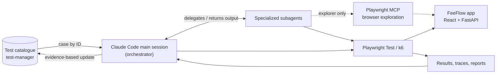

# AI-Assisted Test Automation Workspace

An AI-assisted test automation workspace that combines specialized Claude Code agents, Playwright, TypeScript, Python and k6 to plan, generate, validate, debug and track automated tests. Requirements live in an ID-driven test catalogue. You ask for a case by ID, and the agents turn it into executable automation, check it against every expected result and record the execution evidence in the catalogue. Splitting the work across focused agents keeps the requirement, the implementation and the review independent of each other. The system under test is FeeFlow, a demo school-fee payment app (FastAPI + React) whose payments are all simulated.

## Architecture



Subagents never call each other: the main session calls each one in turn and passes outputs along.

## Specialized Agents

The main Claude Code session is the orchestrator. It picks a workflow from [CLAUDE.md](CLAUDE.md) and delegates to the subagents in [`.claude/agents/`](.claude/agents/).

| Agent | Responsibility |
|---|---|
| `test-case-reader` | Resolves one exact catalogue ID and returns its verbatim specification (read-only). |
| `playwright-mcp-explorer` | Checks unknown screens, flows and endpoints against the running app, using Playwright MCP for UI and source/OpenAPI for API. |
| `test-planner` | Writes a reviewable implementation plan to `tests/plans/<ID>.md`, mapping steps to code and expected results to assertions. |
| `test-automation-engineer` | Implements exactly one case as Playwright Test code, or as a k6 script on explicit request. |
| `test-validator` | Independently reviews the test against the spec, runs it with the real command and classifies failures. |
| `test-catalogue-updater` | Records automation status, script path, result, date and notes through the catalogue CLI. |

## Technology Stack

| Area | Tools |
|---|---|
| AI orchestration | Claude Code, Claude Code subagents |
| Browser exploration | Playwright MCP (`@playwright/mcp`) |
| UI/API automation | Playwright Test 1.63, TypeScript (page objects, API clients, fixtures) |
| Performance testing | k6 with a Node.js runner (smoke by default, load runs opt-in) |
| Application under test | FastAPI + SQLite (Python), React + Vite |
| Test management | Node.js catalogue with a web UI and CLI (`test-manager/`) |

There is no CI/CD integration yet.

## Prerequisites

- **Required:** Python 3.11+, Node.js 18.18+ (20 or 22 LTS recommended) with npm, Claude Code, and Google Chrome or Edge (used by Playwright MCP).
- **Optional:** k6, needed only for performance tests (`winget install k6 --source winget` or `brew install k6`).

## Setup and Installation

```bash
# 1. Clone
git clone https://github.com/Ak79p/test-agents.git
cd test-agents

# 2. Set up the app: backend venv, npm packages, backend/.env and frontend/.env
bash scripts/setup.sh                                          # macOS/Linux
powershell -ExecutionPolicy Bypass -File scripts/setup.ps1     # Windows PowerShell
```

**3. Configure test credentials.** The setup script creates `backend/.env` and `frontend/.env` with working defaults. For the tests, copy `tests/playwright/.env.example` to `tests/playwright/.env` and set `TEST_USER_PASSWORD` and `SECONDARY_USER_PASSWORD` to the seeded demo password listed in [docs/APPLICATION.md §6](docs/APPLICATION.md#6-seeded-credentials-and-data). For k6, optionally copy `tests/k6/env.example` to `tests/k6/.env` (it falls back to the Playwright `.env`). Both files are git-ignored.

**4. Start the app** in three terminals (Windows: `powershell -ExecutionPolicy Bypass -File scripts\start-backend.ps1` and `scripts\start-frontend.ps1`):

```bash
bash scripts/start-backend.sh      # API     http://127.0.0.1:8000  (Swagger at /docs)
bash scripts/start-frontend.sh     # Web UI  http://localhost:5173
cd test-manager && npm start       # Catalogue UI  http://127.0.0.1:5180
```

**5. Install the test tooling and register Playwright MCP:**

```bash
cd tests/playwright
npm install
npm run install:browsers           # Playwright Chromium
npm run test:list                  # confirms the config loads

claude mcp get playwright          # add it only if no "playwright" server exists:
claude mcp add playwright -- npx -y @playwright/mcp@0.0.82 --isolated              # macOS/Linux
claude mcp add playwright -- cmd /c npx -y @playwright/mcp@0.0.82 --isolated       # Windows (PowerShell, not Git Bash)
```

Launch Claude Code (`claude`) from the repository root so it loads `CLAUDE.md` and the agents. `/mcp` should list `playwright` as connected.

## Using the AI Agents

Type plain-language requests in Claude Code. The ID must exist in the catalogue; unknown or duplicated IDs stop the workflow.

```text
Automate AUTH-API-001
Plan PAY-API-001
Automate thorough PAY-API-001
Debug PAY-API-001
Review AUTH-API-001 without implementing it
```

| Workflow | When | What happens |
|---|---|---|
| Fast (`Automate <ID>`) | Existing page objects, clients and fixtures cover the case | The main session implements, runs and records the case without subagents. It stops and recommends thorough mode if the case needs more. |
| Thorough (`Automate thorough <ID>`) | Complex cases: new abstractions, simulation, concurrency, ambiguous specs | reader → explorer (if needed) → engineer → validator → updater |
| Plan-first (`Plan <ID>`) | You want to review the design before any code | reader → explorer → planner writes `tests/plans/<ID>.md` and stops; after you approve it, `Automate <ID>` implements that plan |

`Debug <ID>` fixes test defects only and reports app defects as findings. `Review <ID>` is a static review that changes nothing.

## Running Tests Manually

```bash
cd tests/playwright
npm run test:list          # list tests
npm run test:api           # API tests
npm run test:ui            # UI tests (desktop + mobile)
npx playwright test --grep AUTH-API-001
npm run typecheck && npm run check:locators
npm run report             # open the HTML report

cd ../k6
npm run perf:check         # static check: k6 version, script inspection, API health
npm run perf:smoke         # 1 VU x 1 iteration health check
```

Playwright writes the HTML report to `tests/playwright/playwright-report/` and keeps traces and screenshots of failures in `tests/playwright/test-results/`. k6 summaries go to `tests/k6/results/`.

## Project Documentation

| Document | Contents |
|---|---|
| [CLAUDE.md](CLAUDE.md) | Orchestration rules, workflow modes and guardrails |
| [.claude/README.md](.claude/README.md) | Agent setup, Playwright MCP and troubleshooting |
| [tests/playwright/README.md](tests/playwright/README.md) | Playwright project structure and commands |
| [tests/playwright/FRAMEWORK.md](tests/playwright/FRAMEWORK.md) | Framework conventions: placement, tags, fixtures, page objects |
| [tests/k6/README.md](tests/k6/README.md) | k6 profiles, safety guards and results |
| [test-manager/README.md](test-manager/README.md) | Test catalogue, web UI and CLI |
| [tests/plans/README.md](tests/plans/README.md) | Plan format and approval workflow |
| [docs/APPLICATION.md](docs/APPLICATION.md) | FeeFlow app reference: endpoints, seeded data, simulation |
