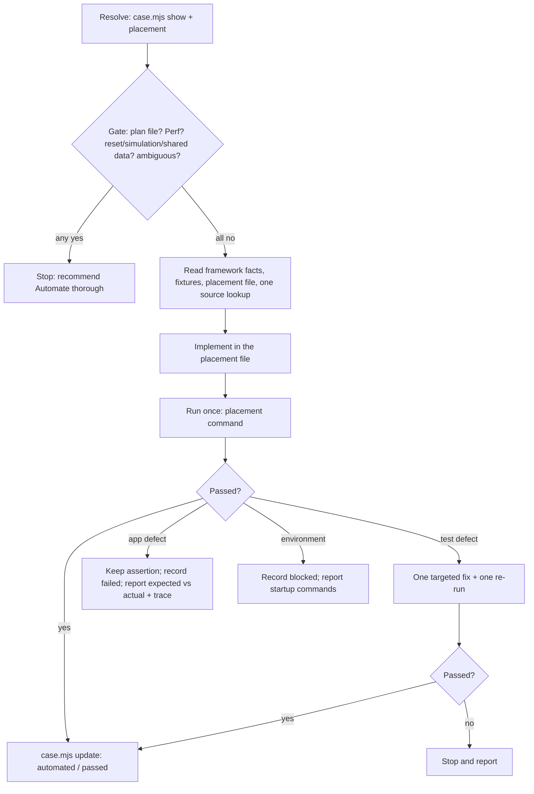
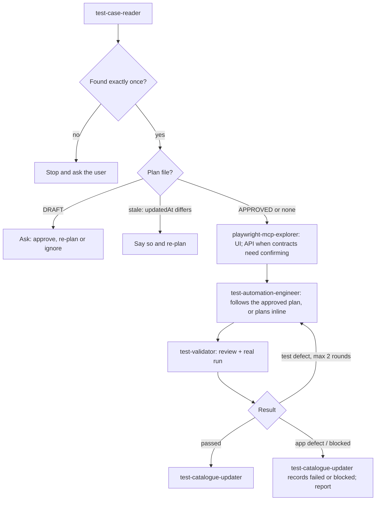
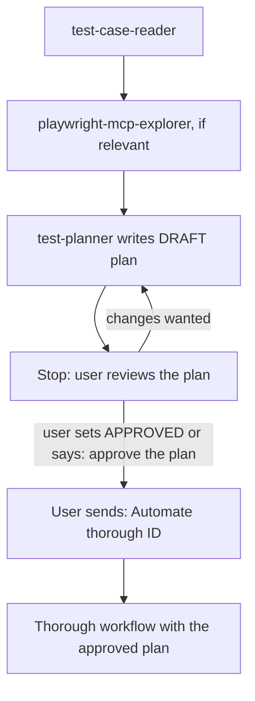

# FeeFlow – SDET Test Automation Workspace

A practice workspace for Playwright (TypeScript) and k6, built around a small demo school-fee payment app. Test cases live in one catalogue with stable IDs, and Claude Code agents plan, automate, review, debug and record them by ID.

> All payments in the demo app are simulated. Nothing calls a real payment provider.

## What's here

| Part | Path | Purpose |
|---|---|---|
| Test catalogue | `test-manager/` | 44 test cases (API 22 · UI 14 · performance 8): steps, expected results, status |
| Claude agents | `.claude/agents/`, rules in `CLAUDE.md` | ID-driven planning and automation workflow |
| Playwright Test | `tests/playwright/` | UI, API and hybrid tests (projects `api`, `ui-chromium`, `ui-mobile`, `hybrid`) |
| k6 | `tests/k6/` | Performance tests |
| Test plans | `tests/plans/` | Implementation plans written by `Plan <ID>` |
| Demo app | `backend/` (FastAPI + SQLite), `frontend/` (React + Vite) | System under test |

```
catalogue (requirements + status) ──► Claude agents ──► Playwright / k6 code ──► demo app
        ▲                                   │ Playwright MCP explores the UI
        └────────── results recorded ◄──────┘
```

## Spin up the demo app

Prerequisites: Python 3.11+, Node.js 18+ (22 used here), Google Chrome or Edge, Claude Code, and k6 (for performance tests).

```powershell
# Windows (PowerShell), from the repo root
powershell -ExecutionPolicy Bypass -File scripts\setup.ps1          # once: venv, npm install, .env files
powershell -ExecutionPolicy Bypass -File scripts\start-backend.ps1  # terminal 1 – API
powershell -ExecutionPolicy Bypass -File scripts\start-frontend.ps1 # terminal 2 – UI
cd test-manager; npm start                                          # terminal 3 – test catalogue
```
```bash
# macOS / Linux
bash scripts/setup.sh
bash scripts/start-backend.sh      # terminal 1
bash scripts/start-frontend.sh     # terminal 2
cd test-manager && npm start       # terminal 3
```

| What | URL |
|---|---|
| Web UI | http://localhost:5173 |
| API | http://127.0.0.1:8000/api/v1 (health: `/api/v1/health`) |
| Swagger / OpenAPI | http://127.0.0.1:8000/docs · http://127.0.0.1:8000/openapi.json |
| Test catalogue | http://127.0.0.1:5180 |

**Demo login:** `thandi.mokoena@example.com` / `Password123!`. Every seeded account uses this password.

## Where things live

| Item | Location |
|---|---|
| UI source | `frontend/src/` (pages in `frontend/src/pages/`, stable `data-testid`s on every interactive element) |
| API source | `backend/app/` (routers in `backend/app/routers/`, payment logic in `backend/app/services/`) |
| API collection | `postman/SchoolFees.postman_collection.json` + `postman/SchoolFees.local.postman_environment.json` |
| Seed data | `backend/app/seed.py`: 5 demo parents + 50 `loadtestNNN@example.com` accounts; due dates are relative to the seed day |
| Database | `backend/data/app.db` (SQLite, created and seeded on first start) |
| Reset data | `POST http://127.0.0.1:8000/api/v1/dev/reset`, or `scripts\reset-db.ps1` / `bash scripts/reset-db.sh` |
| Test catalogue data | `test-manager/data/catalogue.json` (CLI: `node test-manager/scripts/case.mjs show <ID>`) |
| Simulated test cards | `GET /api/v1/dev/test-cards` (e.g. `4242 4242 4242 4242` succeeds, `4000 0000 0000 0002` is declined) |

Full app reference (endpoints, payment lifecycle, delay and failure simulation, all seeded accounts): [docs/APPLICATION.md](docs/APPLICATION.md).

## Set up the test tooling

```powershell
cd tests\playwright
npm install
Copy-Item .env.example .env      # set TEST_USER_PASSWORD and SECONDARY_USER_PASSWORD (Password123!)
npm run test:list                # confirms the Playwright config loads

claude mcp get playwright        # should say "Connected". If missing (PowerShell, not Git Bash):
claude mcp add playwright -- cmd /c npx -y @playwright/mcp@0.0.82 --isolated
k6 version                       # performance tests only
```
macOS: `cp .env.example .env` and `claude mcp add playwright -- npx -y @playwright/mcp@0.0.82 --isolated`.

Start Claude Code in the repo root (`claude`). `/mcp` should list `playwright` as connected.

## Using the Automation Agents

The agents are Claude Code **subagents** defined in [`.claude/agents/`](.claude/agents/). Your main Claude Code session is the orchestrator: it reads your request, picks a mode from the rules in [CLAUDE.md](CLAUDE.md), and calls each agent in turn. Subagents can't call each other. There are no slash commands, skills, hooks or external workflow engines involved. You type a plain request, such as `Automate AUTH-API-001`. `CLAUDE.md` holds the operational rules and this section explains how to use them. Framework conventions (placement, tags, fixtures, page objects) are in [tests/playwright/FRAMEWORK.md](tests/playwright/FRAMEWORK.md).

### The agents

| Agent | Role | Writes |
|---|---|---|
| `test-case-reader` | Resolves the exact ID (`case.mjs show`) and returns the spec word for word, with one acceptance criterion per expected result, the type/target and open questions | nothing |
| `playwright-mcp-explorer` | Checks the real app when something is unknown: the browser via Playwright MCP for UI cases, backend source, Swagger and read-only curl for API cases | nothing |
| `test-planner` | Turns the spec into a reviewable plan: framework changes, step → code and expected result → assertion mapping, data, cleanup, risks | `tests/plans/<ID>.md` only |
| `test-automation-engineer` | Implements the one requested case in the file given by `case.mjs placement <ID>`, following the approved plan if there is one | test code (and framework code an approved plan lists) |
| `test-validator` | Reviews the code against the spec (and plan), runs it with the real command, and classifies failures as test defect, app defect or environment | nothing |
| `test-catalogue-updater` | Records status, script path, result, date and an evidence note with `case.mjs update`, only from verified results | catalogue tracking fields only |

Orchestration is kept lean on purpose:
- The reader's output is passed verbatim, so no agent re-reads or reinterprets the requirement.
- Exploration happens only when a locator, message or contract can't be confirmed from existing code.
- Later findings are passed as short summaries.
- Fast mode skips subagents entirely.
- None of this relaxes an acceptance criterion: every expected result becomes an exact assertion.

### Choosing a mode

| Mode | Use it when | Prompt |
|---|---|---|
| **Fast** (default) | The case is straightforward. The preconditions already hold, the test data is available and isolated, no reset, simulation change or shared-data setup is needed, the framework already supports the layer, and the expected results are unambiguous | `Automate AUTH-API-001` |
| **Thorough** | The case involves `dev/reset` or `dev/simulation`, shared or persistent data, payments or other state changes, uncertain cleanup or rerun behaviour, unverified auth or API contracts, or unresolved preconditions. Also use it once an approved plan exists | `Automate thorough PAY-API-001` |
| **Plan-first** | The case is risky, or needs framework changes you want to review before any code is written | `Plan PAY-API-001` |
| **Review** | You want a static check of the spec or an existing script, with no code or catalogue changes | `Review AUTH-API-001 without implementing it` |
| **Debug** | An automated case fails | `Debug PAY-API-001 – it fails at step 2 with a 409` |
| **Update** | You ran a case manually and want the result recorded | `Update AUTH-UI-002: I ran it manually today and it failed – the email error message did not appear` |
| **k6** | A Performance (`*-PERF-*`) case | `Implement the k6 test for FEE-PERF-001` |

**Fast mode decides for itself whether it applies.** Before writing anything it runs a gate check. It stops and recommends `Automate thorough <ID>` if a plan file exists, the case is a Performance case, it needs `dev/reset`, simulation changes or shared-data setup, the spec is ambiguous, or the behaviour can't be settled from existing tests plus one source lookup. Being an API case doesn't make a case fast-mode safe. For example, `PAY-API-001` and `PAY-API-002` create payments on the shared `loadtest050` account, so they go through Thorough or Plan-first.

**Thorough mode** runs the full agent chain. It confirms endpoints, data and cleanup through the explorer, implements through the engineer, and has the validator run the test before anything is recorded.

### Copy-paste prompts

**A. Automate a single straightforward case.** Appropriate when the case passes the fast-mode gate.
```text
Automate AUTH-API-001
```
Claude reads the case and its placement, follows FRAMEWORK.md, then adds the test to the prescribed file with the prescribed tags (here `tests/playwright/api/auth-api.spec.ts`, tags `@api @auth`). It runs that one test and records the verified result. If the ID already has a test, Claude edits it in place.

**B. Plan a risky case before implementation.** Appropriate for resets, shared data, payments or new fixtures.
```text
Plan PAY-API-001
```
This writes `tests/plans/PAY-API-001.md` with status `DRAFT` and changes no test code and no catalogue record. You can add guidance, e.g. `Plan AUTH-API-001 by extending the framework with a reusable API login fixture`.

**Approve the plan:** set `Plan status` to `APPROVED` in the file, or tell Claude:
```text
approve the plan for PAY-API-001
```

**C. Execute an approved plan.**
```text
Automate thorough PAY-API-001
```
The engineer implements exactly the approved plan, including its framework changes, and makes no unrelated changes. The validator checks the code against the plan and the spec and runs it. The updater records the result only after a verified run. A `DRAFT` plan is never implemented automatically: Claude asks whether to approve it, re-plan or ignore it.

**D. Batches.** There is no batch command. Automate cases one at a time:
```text
Automate AUTH-API-001
Automate AUTH-API-002
```
`CLAUDE.md` lets the engineer implement more than one case only when you explicitly ask for a batch, and it defines no syntax or tooling for that. If you do ask, keep the batch to independent, fast-mode-safe cases.

**E. Debug a failed case.**
```text
Debug PAY-API-001 – it failed in CI at step 2; find the root cause and make the smallest justified fix without weakening any assertion
```
The validator runs the test and classifies the failure. The engineer fixes **test defects only**, in at most two engineer → validator rounds. An app defect is reported with expected vs actual and the trace path, and the assertion stays.

**F. Review a framework change.** There is no dedicated mode for this, so it's a normal request:
```text
Review the uncommitted changes to tests/playwright/fixtures, pages, config and the agent instructions against tests/playwright/FRAMEWORK.md and CLAUDE.md. Run npm run typecheck and the targeted tests for anything affected (e.g. npm run test:ui), report problems, and don't change test assertions or catalogue records.
```

### Orchestrated workflows

**Fast** (`Automate <ID>`): the main session only, no subagents, one fix at most.


**Thorough** (`Automate thorough <ID>`):


**Plan-first** (`Plan <ID>`, then approval, then `Automate thorough <ID>`):

A plan never moves on to implementation by itself: both the approval and the `Automate thorough` request come from you.

### Writing good requests

- Use the **exact catalogue ID**. Unknown or duplicated IDs are never guessed: Claude stops and asks.
- Say `thorough` or `Plan` when you already know a case is risky. Otherwise fast mode's gate decides.
- Don't paste acceptance criteria. The catalogue is authoritative and is read verbatim. Add constraints only when they matter (e.g. "…by extending the framework with an auth fixture").
- **Never put credentials in prompts.** They belong in `tests/playwright/.env` (see `.env.example`).
- Don't ask the agents to change application code to make a test pass. App defects are findings.
- Request one case at a time (see D above).
- When reviewing a plan, check destructive operations (`dev/reset` revokes every token), shared accounts, cleanup and rerun safety.
- Accept a catalogue update only with real run evidence. The note records the command and the reporter summary.

### Troubleshooting

| Symptom | What to do |
|---|---|
| "Test case … was not found" or "duplicated" | Check the ID with `node test-manager/scripts/case.mjs list` (filters: `--layer`, `--status`, `--result`). Claude never substitutes a similar ID. |
| Catalogue update rejected: "scriptPath must be …" | The path is derived from the ID. Get it with `node test-manager/scripts/case.mjs placement <ID>`. |
| Fast mode stops and recommends thorough | That's the gate working. Use `Automate thorough <ID>`, or `Plan <ID>` first. |
| A plan stays `DRAFT` | Nothing is implemented from a DRAFT. Set `Plan status` to `APPROVED` or say "approve the plan for &lt;ID&gt;". If the case changed since planning (`Catalogue updatedAt` differs), re-plan. |
| The app contradicts the spec | It's reported as an app defect: the assertion stays and the result is `failed`, with the trace path. Open the trace with `npx playwright show-trace test-results/<test>/trace.zip` (from `tests/playwright`). Fix the app or the catalogue spec yourself. |
| Missing credentials or env values | `config/env.ts` throws "Missing environment variable …". Copy `.env.example` to `.env` and set the passwords. Claude reports this as a blocker and never fills them in. |
| App not running | `scripts\start-backend.ps1` and `scripts\start-frontend.ps1` (macOS/Linux: `bash scripts/start-*.sh`). Health: `http://127.0.0.1:8000/api/v1/health`. |
| A test passes alone but fails with others | Look for shared state: a `dev/reset` in one test revokes other sessions' tokens, shared accounts like `loadtest050` are touched by other tests, or a k6 run uses the same accounts concurrently. Reproduce with `npx playwright test --grep <ID> --repeat-each=3` and with the full project (`npm run test:api` / `npm run test:ui`). Keep 1 worker. |
| Agent runs are slow | Use fast mode for simple cases, and don't ask for exploration that existing tests or source already answer. If a subagent re-reads everything, check that its agent file is current. More agent and MCP troubleshooting: [.claude/README.md](.claude/README.md#troubleshooting). |
| Validate the catalogue | `cd test-manager && npm run validate` |

## Run tests without Claude

```bash
cd tests/playwright
npx playwright test --grep AUTH-API-001           # one case by ID
npm run test:ui                                   # by category: test:ui | test:api | test:hybrid
npx playwright test --grep "@auth"                # by tag
npm run pw:ui                                     # Playwright UI mode
npm run report                                    # last HTML report (traces/screenshots on failure)

cd tests/k6 && k6 run scripts/FEE-PERF-001.js     # once the script exists
```

## More documentation

[CLAUDE.md](CLAUDE.md) (workflow rules) · [.claude/README.md](.claude/README.md) (agents, MCP setup, troubleshooting) · [tests/playwright/README.md](tests/playwright/README.md) · [tests/k6/README.md](tests/k6/README.md) · [test-manager/README.md](test-manager/README.md) · [tests/plans/README.md](tests/plans/README.md) · [docs/APPLICATION.md](docs/APPLICATION.md)
